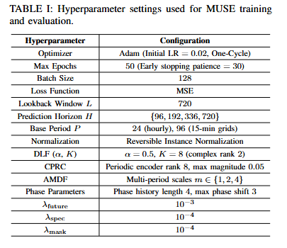
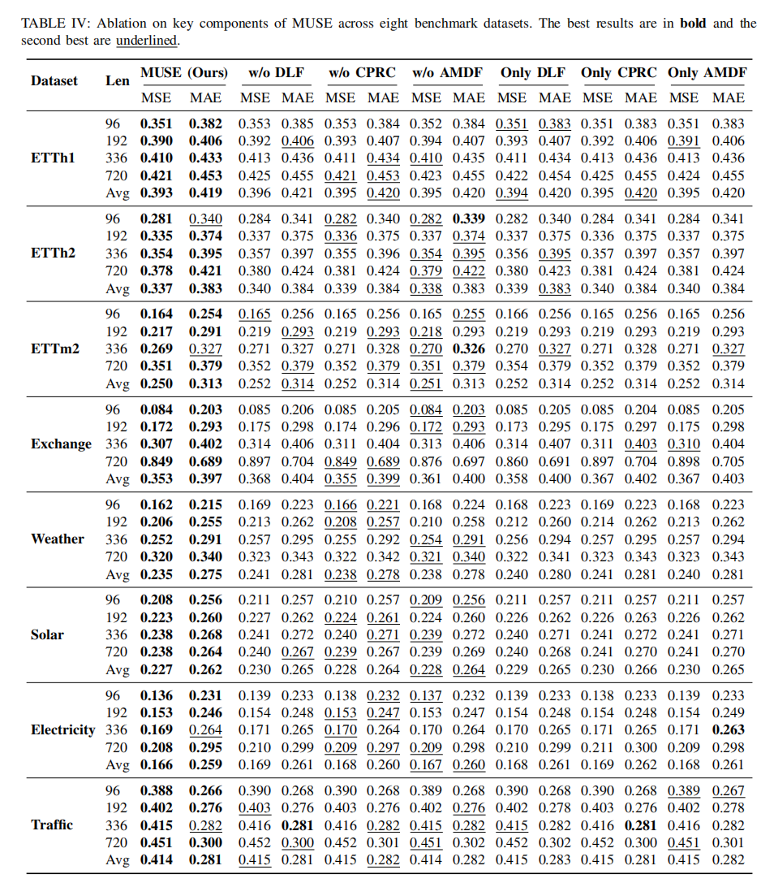

# MUSE:  Component-Guided Latent Space Supervision with Multi-Period Calibration for Time Series Forecasting

## Experimental Settings (Appendix A)
We implement MUSE with PyTorch and configure the hyperparameters to ensure a fair comparison with baseline methods. 

  

## Experiments: Ablation Benchmark (Appendix B)
Statistical significance validation of MSE performance between MUSE (Full) and ablation variants across five matched random seeds (2023–2027). Metrics are reported as mean ± std, with p-values computed with paired two-tailed t-tests.

  

*(You can also find the full results screenshot here:)*

  

